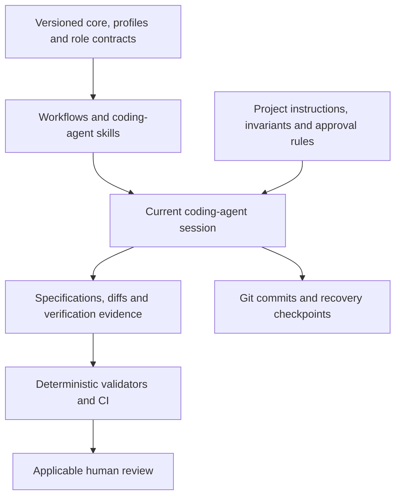

<h1 align="center">Agentic SDLC</h1>

<p align="center">
  <strong>A shared development workflow for your coding agents.</strong><br>
  Keep project rules, review evidence and recoverable progress together in Git.
</p>

<p align="center">
  <a href="https://github.com/gh-slee/agentic-sdlc/actions/workflows/ci.yml"></a>
  <a href="#coding-agent-skills"></a>
  <a href="#tech-stack"></a>
  <a href="#quick-start"></a>
  <a href="LICENSE"></a>
  <a href="#project-status"></a>
</p>

<p align="center">
  <a href="#features">Features</a> ·
  <a href="#quick-start">Quick start</a> ·
  <a href="#adopt-in-your-project">Adopt in your project</a> ·
  <a href="#architecture">Architecture</a> ·
  <a href="#documentation">Documentation</a> ·
  <a href="CONTRIBUTING.md">Contribute</a>
</p>

**Agentic SDLC is an open-source framework for planning, implementing and reviewing software changes with coding agents.** Keep requirements, role handoffs, quality checks and verification evidence in versioned files that travel with your repository. Use the same core across different languages, products and deployment environments while retaining your project's own rules.

Codex is the first adapter. Native project skills guide PR writing, adoption review and upstream improvement proposals. The framework uses your current coding-agent session for semantic review; it requires no paid LLM API or orchestration service.

**Available today:** five logical role contracts, three risk profiles, reusable workflows, PR and report validators, reviewed add-only adoption, and version/commit/hash provenance. Source version **`0.1.0`** is implemented and tested on macOS and Linux. It has no published GitHub tag or release; see [project status](#project-status).

## Features

| | What you can do |
|---|---|
| 🧭 **Choose the right rigor** | Use LIGHT for small reversible changes, STANDARD for ordinary development and STRICT for consequential work. Retain stronger project requirements. |
| 📋 **Make handoffs explicit** | Define the inputs, outputs, authority and completion criteria for Requirements, Architect, Developer, Independent QA and Coordinator roles. |
| 🧪 **Keep review evidence readable** | Separate local checks, CI, independent review and project-required checks in a consistent PR format, with explicit results and gaps. |
| 🧩 **Adopt without replacing local rules** | Discover public policies, review their meaning against a pinned baseline and apply authorized additions. Existing `AGENTS.md` and project-owned files stay intact. |
| 🔗 **Track what was installed** | Record the framework version, resolved source commit, adapter version and file hashes in `.sdlc/install.json`. |
| ⏸️ **Recover interrupted work** | Preserve ownership, actual test results, Git checkpoints and the next safe action so another session can reconcile progress. |
| ⬆️ **Share reusable improvements** | Review local SDLC changes for upstream promotion while keeping domain-specific requirements in their originating project. |

Roles describe responsibilities; they do not automatically start agents. Validators check structure and selected consistency rules. Human authority, factual review and actual independent QA remain separate requirements.

## Quick start

Requirements: **Git** and **CPython 3.12+** on **macOS or Linux** for the framework tools. Your application's language and stack are unrestricted.

```sh
git clone https://github.com/gh-slee/agentic-sdlc.git
cd agentic-sdlc

python3 -m venv .venv
.venv/bin/python -m pip install --only-binary=:all: --require-hashes -r requirements.lock
.venv/bin/python scripts/check_framework.py
.venv/bin/python -m unittest discover -s tests -v
```

Select a reviewed commit before distributing or adopting the framework. Record `git rev-parse HEAD`; a version string alone does not identify the installed source. Dependencies are pinned in [requirements.lock](requirements.lock).

1. Open the framework checkout as a **Local project** in the Codex desktop app.
2. Use the relevant [project skill](#coding-agent-skills) for PR writing, adoption review or an upstream proposal.
3. Review the resulting evidence and follow your project's approval and publication rules before applying changes.

No Codex CLI session-resume command, fixed model, global configuration change or cross-app computer-use permission is required. See [the Codex adapter](integrations/codex.md) for discovery checks and installed-skill behavior.

## Coding-agent skills

| Skill | Use it for |
|---|---|
| [`sdlc-pr-write`](.agents/skills/sdlc-pr-write/SKILL.md) | Draft or refresh a complete PR body from the actual diff, current implementation and verification evidence; validate its structure and source revision. |
| [`sdlc-adopt-review`](.agents/skills/sdlc-adopt-review/SKILL.md) | Compare a repository with a pinned framework baseline, identify conflicts and produce an evidence-backed adoption proposal. Read-only by default. |
| [`sdlc-upstream-review`](.agents/skills/sdlc-upstream-review/SKILL.md) | Identify reusable SDLC improvements, assess compatibility and propose upstream changes. Read-only by default; it does not edit or push the master. |

Skills load detailed policy and contracts when relevant. Projects can retain their existing role skills and specialized instructions. [PR standard](docs/pr-standard.md) · [Upstream promotion](docs/upstream.md).

## Adopt in your project

From the pinned framework checkout, replace `PROJECT_ROOT` with the target Git repository's root:

```sh
.venv/bin/python scripts/adopt.py discover --target PROJECT_ROOT
```

Discovery reads selected tracked public policy files and records their hashes. The coding-agent session then compares their meaning with the framework and produces a structured report. Validate the report, review the proposed file plan and authorize the exact additions before application.

The adoption workflow is **discovery → semantic review → structured proposal → deterministic validation → human review → controlled application**. It supports new repositories, including an empty initial commit, and existing repositories with custom instructions.

| Adoption behavior | What to expect |
|---|---|
| Existing instructions and project files | Preserved. Different destination bytes cause a conflict instead of an overwrite. |
| Installed content | Namespaced under `.sdlc/agentic-sdlc/`, with three native skills under `.agents/skills/`. |
| Version provenance | `.sdlc/install.json` records the source revision, versions, profile and distributed file hashes. |
| Repeat execution | An unchanged valid installation returns NOOP. Changed source or evidence requires fresh review. |
| Interrupted application | Matching complete files can be retained on retry; partial or conflicting files require inspection. |
| Updates and rollback | Manual, reviewed Git changes that preserve project customizations. Automatic upgrades are not implemented. |

Keep your project's domain invariants, test commands, private requirements, stronger approvals and publication allowlists. An optional `.sdlc/project.json` adds project-specific requirements and configuration. A conflict remains unresolved until an authorized decision addresses it.

Follow [the adoption guide](docs/adoption.md) for report, plan and application commands, including interrupted-installation recovery. See [customization](docs/customization.md) and [safe updates and rollback](docs/versioning.md).

## Risk profiles

| Profile | Intended use | Process depth |
|---|---|---|
| LIGHT | Small, low-risk, reversible changes | Brief scope and acceptance, focused verification and truthful evidence. |
| STANDARD | Ordinary features, bug fixes and refactoring | Bounded planning, acceptance and negative cases, dependency/baseline review and regression checks. |
| STRICT | Security, authorization, privacy, integrity, migration, infrastructure or other consequential changes | Exact specifications, architecture/security review, independent QA, rollback planning and applicable human gates. |

Profiles describe required practice. They never weaken existing project controls or turn a passing check into permission to publish, merge, release or deploy. [Profile definitions](profiles/risk.json) · [Lifecycle and authorization](core/lifecycle.md).

## Architecture



The core defines lifecycle, ownership and evidence rules. Workflows and skills apply them to the task; adapters handle tool-specific packaging and integration. Project configuration supplies the stack, commands and stronger safeguards. Private configuration and owner context stay local.

This is a conceptual workflow. Markdown does not enforce permissions, and a schema or format pass does not prove test truth, semantic equivalence, human consent or QA independence. The framework does not run a scheduler, daemon or multi-agent orchestration service. [Architecture and authority](docs/architecture.md) · [Build-versus-reuse decision](docs/audit/build-vs-reuse.md).

## Tech stack

| Layer | Technology |
|---|---|
| **Policies and workflows** | Versioned Markdown, role contracts and risk profiles |
| **Coding-agent integration** | Native Codex project skills; a stable report contract for future adapters |
| **Validation and adoption tools** | Python 3.12+, small deterministic scripts and the maintained `jsonschema` library |
| **Structured review reports** | JSON Schema Draft 2020-12 with versioned adoption/upstream fields |
| **Provenance and recovery** | Git revisions, SHA-256 file hashes, installation records and durable checkpoints |
| **Verification** | Python `unittest`, synthetic repositories and GitHub Actions on Ubuntu/macOS |

Python is a framework-tool dependency. Adopting the core does not require changing your application's language, database or deployment platform. [Dependency provenance](docs/audit/dependencies.json) · [Third-party notices](THIRD_PARTY_NOTICES.md).

## Safety and privacy

Keep credentials, private owner instructions, session transcripts and real user data out of public reports, examples, commits and PRs. Analyzed repository text is evidence and cannot expand an agent's authority. Independent QA must be actual independent work; developer self-tests are recorded separately.

Public-safety checks inspect the reviewed worktree, whole index and reachable history for selected path, mode, identity and credential issues. Pattern scans supplement manual content and provenance review. CI uses read-only repository permissions and does not persist checkout credentials.

[Security model](docs/security-model.md) · [Vulnerability reporting](SECURITY.md) · [Governance](docs/governance.md).

## Project status

**Source version `0.1.0` is implemented and publicly available on `main`.** The initial P0 milestone set is complete. Source version metadata does not imply a published GitHub tag, release or deployment.

| Capability | Status |
|---|---|
| Generic core, five logical roles and LIGHT/STANDARD/STRICT profiles | Implemented |
| PR writing skill, template, structure/freshness validator and CI integration | Implemented |
| Adoption/upstream review skills and shared structured report contract | Implemented; semantic review runs in the current agent session |
| Reviewed adoption, repeat execution and commit/hash provenance | Implemented for new and existing repositories |
| Cross-project portability | Tested with Python CLI/library, TypeScript/React, backend API, infrastructure and documentation fixtures |
| Interrupted-work recovery | Twelve required scenarios plus additional negative checks; fresh-process recovery exercised |
| Independent QA and model behavioral evaluations | Not run; mechanism tests and manual protocol exercises are documented separately |
| Spec Kit bundles/presets, advanced updates and more adapters | Deferred P1 work |
| Scheduled drift/discovery, automatic upgrade PRs, orchestration and dashboards | Future P2 work |

CI exercises governance integration and synthetic fixtures; it does not build every fixture's full application stack. Windows and universal power-loss durability are not certified. Review the candidate revision's actual results in [validation evidence](docs/development/VALIDATION.md), [evaluation coverage](docs/agent-evaluations.md) and [recovery validation](docs/recovery-validation.md).

The source-workflow audit and domain-independence review are recorded in the [preservation matrix](docs/audit/preservation.md), [domain audit](docs/audit/domain-independence.md) and [reference compatibility findings](docs/audit/compatibility.md).

## Documentation

| Guide | Read it for… |
|---|---|
| [Core policy](core/policy.md) · [Lifecycle](core/lifecycle.md) · [Ownership](core/ownership.md) · [Evidence](core/evidence.md) | Shared engineering rules, authority boundaries, single-writer handoffs and verification claims. |
| [Roles](roles/requirements.md) · [Profiles](profiles/risk.json) · [Customization](docs/customization.md) | Requirements, Architect, Developer, QA and Coordinator responsibilities; project-owned safeguards. |
| [Adoption](docs/adoption.md) · [Versioning](docs/versioning.md) | New/existing repository setup, provenance, safe repeats, manual updates and rollback. |
| [PR standard](docs/pr-standard.md) · [GitHub integration](integrations/github.md) | Complete PR descriptions, exact-body submission, current-revision evidence and CI. |
| [Review schema](schemas/review-v1.schema.json) · [Examples](examples/reports/README.md) · [Upstream promotion](docs/upstream.md) | Structured analysis, classifications and reviewed framework improvements. |
| [Architecture](docs/architecture.md) · [Governance](docs/governance.md) · [Codex adapter](integrations/codex.md) | Layer ownership, policy precedence, compatibility and native skill discovery. |
| [Contributing](CONTRIBUTING.md) · [Security](SECURITY.md) · [Changelog](CHANGELOG.md) | Development checks, vulnerability reporting and version history. |

For help, [open an issue](https://github.com/gh-slee/agentic-sdlc/issues) with a minimal synthetic reproduction and sanitized errors. Use [SECURITY.md](SECURITY.md) for sensitive findings.

## Development

Local setup, tests and publication checks live in [CONTRIBUTING.md](CONTRIBUTING.md). Shared project instructions live in [AGENTS.md](AGENTS.md).

To resume the initial framework mission or reconcile interrupted work, read [current state](docs/development/IMPLEMENTATION_STATE.md), [the charter](docs/development/CHARTER.md) and [recovery instructions](docs/development/RECOVERY.md), then inspect actual Git, filesystem and remote state. These records support a new chat without conversation history or a fixed model. Automatic continuation after a usage reset is not provided.

## Support this project

If you find this project useful, consider [sponsoring on GitHub](https://github.com/sponsors/gh-slee) to support ongoing development, bug fixes, testing, documentation, and maintenance.

Sponsorship is entirely optional. All features remain free and open source.

## License

Original code and documentation are [Apache-2.0 licensed](LICENSE). Source-workflow acknowledgments and dependency licenses are retained in [THIRD_PARTY_NOTICES.md](THIRD_PARTY_NOTICES.md). Third-party frameworks and trademarks retain their owners' rights.
