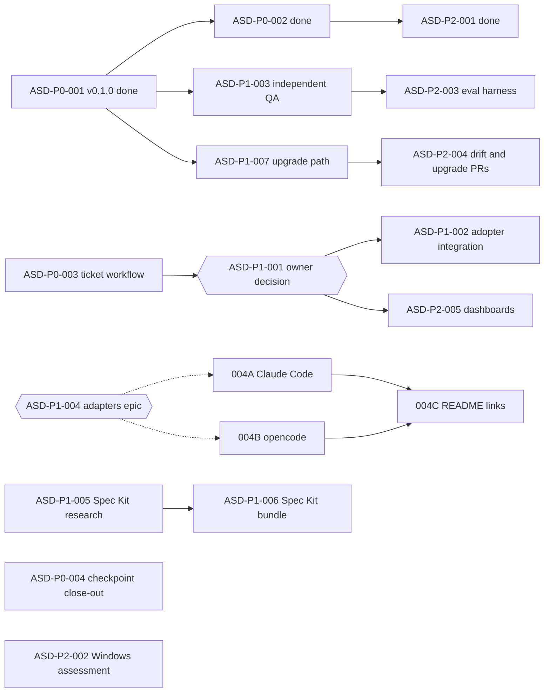

# End-to-end roadmap

`python3 scripts/tickets.py list` is the live status; this page explains the order.
Ticket prefix: `ASD`.

## Where things stand

- **Done:** v0.1.0 is built, verified and public on `main` (ASD-P0-001: milestones
  M0-M10 in [IMPLEMENTATION_PLAN.md](../docs/development/IMPLEMENTATION_PLAN.md)),
  plus README alignment (ASD-P0-002) and GitHub Sponsors (ASD-P2-001). The latest
  `main` CI run passed on Ubuntu and macOS.
- **In review:** this ticket workflow (ASD-P0-003).
- **Gaps carried from the release:** independent QA and model behaviour evaluations
  were not run; Spec Kit bundles, advanced updates and more adapters were deferred
  (P1); scheduled drift discovery, upgrade PRs, orchestration and dashboards are P2;
  Windows is not validated.
- No open GitHub issues; no open PRs before this one; no unmerged branches with
  unique work.

## Phases

| Phase | Outcome | Tickets |
|---|---|---|
| 0. Done | v0.1.0 published and documented | ASD-P0-001, ASD-P0-002, ASD-P2-001 |
| 1. Parallel-agent readiness | Ticket workflow merged; checkpoint docs current | ASD-P0-003, ASD-P0-004 |
| 2. Confidence in v0.1.0 | Independent QA of validators and gates | ASD-P1-003 |
| 3. More agents | Claude Code and opencode adapters; ticket workflow decision | ASD-P1-001, ASD-P1-002, ASD-P1-004 (A, B, C) |
| 4. Deferred integrations | Spec Kit re-evaluation and optional bundle; reviewed upgrade path | ASD-P1-005, ASD-P1-006, ASD-P1-007 |
| 5. Later | Windows assessment, automated evaluations, drift/upgrade PRs, dashboards | ASD-P2-002 ... ASD-P2-005 |

## Dependency graph

## Priority changes and mapping from older plans

- The implementation plan's tasks M0.1-M10.2 (all P0, all DONE) map to the epic
  ASD-P0-001 rather than 22 separate tickets; the plan stays the detailed record.
- Its "P1: optional Spec Kit integration / advanced updates / additional adapters"
  maps to ASD-P1-005/006, ASD-P1-007 and ASD-P1-004.
- Its "P2: orchestration, scheduling, dashboards" maps to ASD-P2-004 and ASD-P2-005.
- **Raised to P1:** independent QA (ASD-P1-003). The release recorded it as NOT RUN,
  and every later feature builds on those validators.
- **New P0:** ASD-P0-004, because IMPLEMENTATION_STATE.md still points a fresh agent
  at already-finished CI verification.
- Windows validation and behaviour evaluations were listed as limitations, not
  planned work; they are now P2 tickets (ASD-P2-002, ASD-P2-003).

## Parallel lanes

Tickets in different lanes share no exclusive resource, so different agents can
work them at the same time. Work inside a lane is sequential.

| Lane | Resource | Now | Next |
|---|---|---|---|
| Ticket tooling | `ticket-tooling`, `publication-audit`, `agent-instructions`, `adr-log` | ASD-P0-003 (in review) | ASD-P2-005 |
| Checkpoint docs | `development-state` | ASD-P0-004 | - |
| Independent QA | none (read-only) | ASD-P1-003 | ASD-P2-003 (`evaluation-harness`) |
| Spec Kit | `audit-spec-kit` | ASD-P1-005 | ASD-P1-006 (`adoption-engine`, `dependency-lock`) |
| Adapters | `adapter-claude-code`, `adapter-opencode` | after owner approval: ASD-P1-004A and ASD-P1-004B in parallel | ASD-P1-004C (`readme`) |
| Adoption engine | `adoption-engine` | ASD-P1-007 after owner approval | ASD-P2-004 |
| Windows | `audit-windows` | ASD-P2-002 | - |

Suggested split for today, without new owner approvals:

1. **Frontier agent** (a session that did not write v0.1.0): ASD-P1-003 independent QA.
   It can also do the independent review that ASD-P0-003 needs.
2. **Standard agent:** ASD-P1-005 Spec Kit re-evaluation.
3. **Any-tier agent** (for example opencode with DeepSeek Flash): ASD-P0-004.
4. **Fourth agent, optional:** ASD-P2-002 Windows assessment.

## Owner actions that unlock more parallel work

1. Review and merge the ticket workflow PR (ASD-P0-003) after its independent review.
2. Decide ASD-P1-001 (recommended: optional adapter, core unchanged). Unlocks
   ASD-P1-002 and ASD-P2-005.
3. Approve adapter scope on ASD-P1-004 (recommended: docs-only first). Unlocks two
   parallel lanes, ASD-P1-004A and ASD-P1-004B.
4. Approve ASD-P1-007 (reviewed upgrade path). Unlocks the adoption-engine lane.
5. After ASD-P1-005 reports, approve or decline ASD-P1-006.
6. Set budget and providers for ASD-P2-003 if automated evaluations are wanted.
